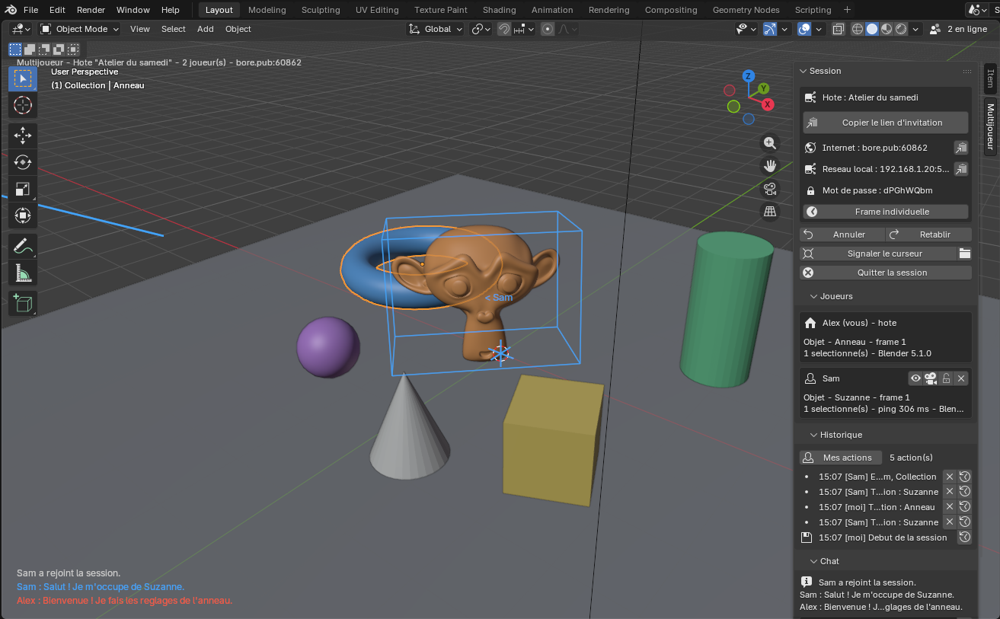
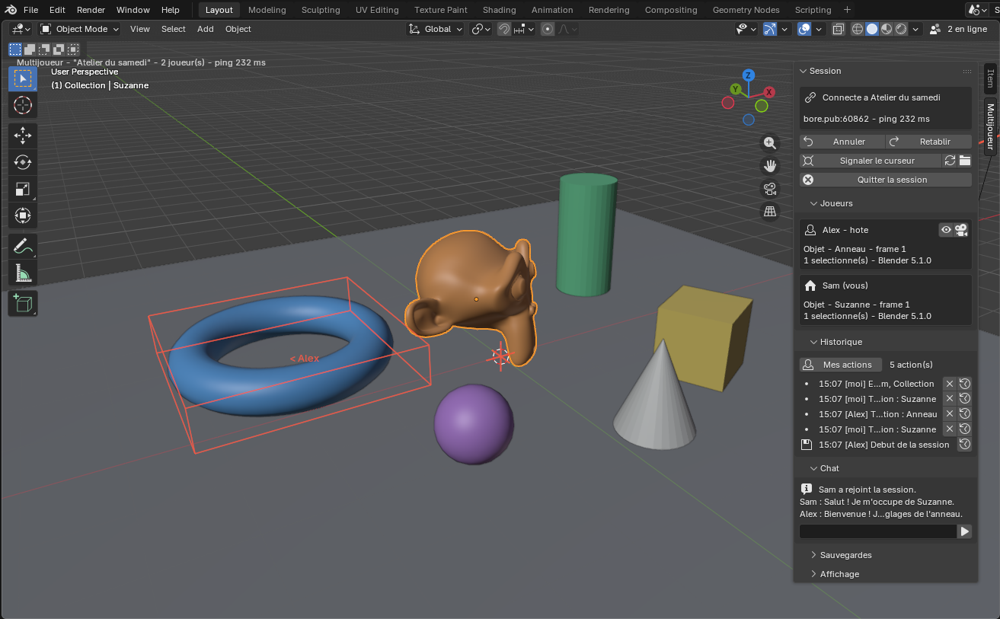
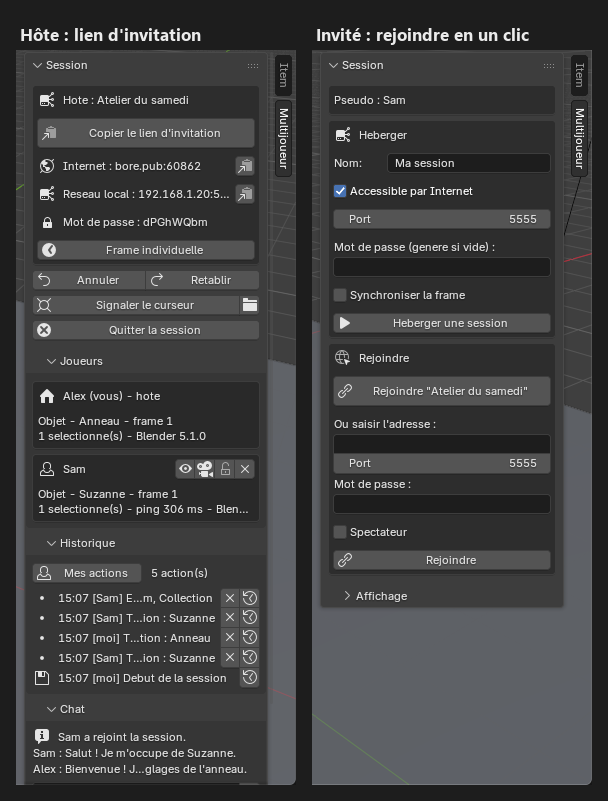

# Blender Multiplayer

Éditez **la même scène Blender à plusieurs, en temps réel**. Chacun travaille de son côté, voit les autres se déplacer dans la scène, voit ce qu'ils sélectionnent, créent et modifient, avec un historique collaboratif (Ctrl+Z partagé, retour à n'importe quel point), des autosauvegardes et des sauvegardes restaurables.



*Vue de l'hôte (Alex) : la caméra et le cadre bleus montrent où regarde Sam et ce qu'il a sélectionné ; les messages du chat s'affichent dans la vue ; le panneau **Multijoueur** donne le lien d'invitation, les joueurs connectés et l'historique partagé.*

| Vue de l'invité (Sam), connecté par Internet | Panneaux de l'hôte et de l'invité |
|---|---|
|  |  |

**[⬇ Télécharger l'addon](https://lburdier.github.io/blender-multiplayer/)** · [Dernière version sur GitHub](https://github.com/lburdier/blender-multiplayer/releases/latest)

Testé sous **Blender 4.3, 5.0 et 5.1**, y compris en mélangeant les versions 5.x (hôte 5.1 et client 5.0, et l'inverse), en réseau local comme par Internet. Les API qui changent d'une version à l'autre sont détectées à l'exécution, pour viser aussi les versions suivantes (5.2, 5.3…).

## Installation

**Avec mises à jour automatiques (recommandé)**

1. Blender > *Edit > Preferences > Get Extensions* > menu **Repositories** > **+** > **Add Remote Repository**.
2. URL : `https://lburdier.github.io/blender-multiplayer/index.json`, cocher **Check for Updates on Startup**.
3. Chercher **Blender Multiplayer** dans *Get Extensions* > **Install**.

**Depuis le fichier zip**

1. Télécharger `blender_multiplayer-x.y.z.zip` sur la [page de téléchargement](https://lburdier.github.io/blender-multiplayer/) ou la [dernière version GitHub](https://github.com/lburdier/blender-multiplayer/releases/latest) (sans le décompresser).
2. Blender > *Edit > Preferences > Get Extensions* > menu ⌄ > **Install from Disk…** > choisir le `.zip`.

Dans les deux cas, choisir ensuite son **pseudo** et sa **couleur** dans les préférences de l'extension. L'interface se trouve dans la vue 3D, barre latérale (**N**) > onglet **Multijoueur**.

### Mises à jour

Au démarrage de Blender, l'addon vérifie s'il existe une nouvelle version et **l'installe tout seul** (jamais pendant une session), quel que soit le mode d'installation. On peut aussi la lancer d'un clic (bannière dans l'onglet Multijoueur), ou désactiver l'installation automatique dans les préférences. La vérification respecte le réglage *Autoriser l'accès en ligne* de Blender (*Preferences > System > Network*). Tous les joueurs doivent utiliser la même version de l'addon : les mises à jour automatiques s'en chargent.

## Jouer

**Le plus simple : le lien d'invitation (fonctionne depuis n'importe où, sans VPN ni port à ouvrir)**

1. L'hôte ouvre sa scène > *Héberger* (case **Accessible par Internet** cochée) > **Copier le lien d'invitation** > l'envoie (Discord, mail…).
2. L'invité copie le lien > **Rejoindre avec le lien copié**. C'est tout.

Le lien est **privé** : il contient l'adresse de la session et son mot de passe (généré automatiquement si l'hôte n'en a pas mis). Ouvert dans un navigateur, il affiche simplement le mode d'emploi. Il reste valable tant que la session est ouverte.

| Rôle | Autres façons de faire |
|---|---|
| **Hôte** | Les adresses sont affichées dans le panneau (Internet et réseau local), avec un bouton copier |
| **Joueur** | Saisir l'adresse (`192.168.1.20`, `bore.pub:41234`…, le port peut être inclus) > *Rejoindre*. La scène de l'hôte remplace la vôtre (votre fichier est sauvegardé avant) |
| **Spectateur** | Cocher *Spectateur* avant de rejoindre : on voit tout, on ne peut rien modifier |

- **Réseau local** : adresse IP de l'hôte (ex. `192.168.1.20`), port `5555` par défaut. Le lien d'invitation essaie d'abord le réseau local, puis Internet.
- **Par Internet** : la case *Accessible par Internet* ouvre un tunnel vers un relais TCP public ([bore](https://github.com/ekzhang/bore), serveur `bore.pub`) ; aucun réglage de box n'est nécessaire. Le relais est modifiable dans les préférences (vous pouvez héberger le vôtre avec `bore server`). Un VPN de jeu (Tailscale, ZeroTier…) ou une redirection de port restent possibles.
- **Réseau filtré (école, entreprise, Wi-Fi public)** : ces réseaux ne laissent souvent sortir que le web, et le port au hasard de `bore.pub` (ex. `42304`) y est bloqué ; l'invité voyait alors « l'hôte ne répond pas » partout. Depuis la 1.7.1, l'hôte ouvre aussi une **voie HTTPS** (port 443) par un tunnel rapide Cloudflare gratuit (`trycloudflare.com`, sans compte). Le programme officiel `cloudflared` (~55 Mo) est téléchargé une seule fois chez l'hôte ; l'invité n'a rien à installer. L'adresse `wss://….trycloudflare.com` est ajoutée au lien d'invitation (ligne *HTTPS* du panneau) : attendez qu'elle s'affiche avant de copier le lien. Désactivable dans les préférences (*Voie HTTPS*).
- L'invité essaie **toutes les adresses du lien en même temps** et garde la première qui répond (avant : une par une, jusqu'à 15 s d'attente).
- `127.0.0.1` désigne **votre propre PC** : ce n'est pas l'adresse à utiliser pour rejoindre quelqu'un d'autre.

## Ce qui est synchronisé

- Objets : création, suppression, transformations (envoyées 60 fois par seconde pendant un déplacement, avec un **glissement fluide** chez les autres au lieu de sauts), parents, visibilité, modificateurs (Geometry Nodes avec leurs entrées compris), contraintes, emplacements de matériaux, groupes de vertex, pose des armatures, propriétés personnalisées.
- Maillages : géométrie complète et attributs (UV, couleurs, arêtes vives, index de matériau…), **en direct pendant le mode Édition**, avec un aller-retour bit à bit identique.
- **Canal temps réel** : pendant un geste, seuls les sommets déplacés (mode Édition, Sculpt) et les valeurs des nodes des matériaux et mondes changés sont envoyés, à chaque image. L'état complet part à la fin du geste : il devient la référence et une seule entrée d'historique. Tous les joueurs doivent avoir la version 1.7.0 ou plus pour en profiter.
- **Textures** :
  - les fichiers d'image utilisés par la scène sont **envoyés avec elle** à l'arrivée d'un joueur, y compris les tuiles **UDIM**, ainsi que les polices, sons, vidéos, VDB, Alembic et bibliothèques `.blend` liées ;
  - quand il y a beaucoup de textures à envoyer (plus de 8 Mo), **la scène arrive d'abord** et l'invité peut travailler tout de suite ; les textures suivent en arrière-plan, sans retarder les modifications des autres, et s'affichent au fur et à mesure (avancement dans la barre d'état) ;
  - seuls les fichiers que l'invité n'a pas déjà sont envoyés : ceux reçus lors d'une session précédente restent dans un **cache** (4 Go au plus, dans le dossier de l'addon), et ceux qui existent déjà au même endroit sur son PC (projet synchronisé, deux Blender sur le même PC) sont repris sans passer par le réseau, après vérification de leur contenu ;
  - un fichier de texture **modifié sur le disque** (retouché dans Photoshop, Substance…) est détecté, rechargé et renvoyé à tous automatiquement ;
  - la **peinture de texture** dans Blender est diffusée pendant que l'on peint, même sans enregistrer l'image (dans les deux sens).
- **Modifications faites par d'autres addons** (rig de véhicule, outils d'animation, scripts…) : elles passent par les mêmes données, donc elles sont diffusées en direct comme celles faites à la main. Exemple : la conduite au clavier de l'addon *Jeep Commander Rig* déplace le rig chez tout le monde (environ 30 mises à jour par seconde), les feux allumés par l'addon s'allument partout, et les drivers qu'un addon ajoute (mise à niveau d'un rig) sont transmis aux objets, lumières et caméras. Sur un rig dont certains os ont des drivers (roues, direction), seuls les canaux pilotés restent calculés chez chacun ; les autres os et les propriétés personnalisées (réglages, feux) sont envoyés. Pas besoin d'installer l'addon chez l'invité pour voir le résultat ; il ne lui faut l'addon que pour s'en servir lui-même. Tous les joueurs doivent avoir la version 1.6.0 ou plus (avec une version plus ancienne, la conduite arrive mais pas les drivers ajoutés).
- Matériaux, arbres de nodes, mondes, animations (actions 5.x à slots), armatures (os ajoutés en mode Édition), courbes, textes, Grease Pencil, lattices, metaballs, volumes, cheveux, nuages de points… : envoyés en « blob » (data-block complet), donc fidèles à 100 %.
- **Lumières** : tous les paramètres (couleur, puissance, rayon, cône, température, exposition, réglages Cycles…) et leurs **nodes** ; caméras (dont la mise au point) ; collections ; scènes (**réglages de rendu** : moteur, Cycles, EEVEE, Workbench, débruitage ; réglages de sortie : résolution, images/s, fichier ; unités ; gestion des couleurs ; exclusion de calques). L'invité voit la même image que l'hôte, dans la vue Rendu comme au F12.

Restent **propres à chaque joueur** :
- les réglages liés au **matériel** : périphérique de calcul (GPU/CPU), threads, tuiles, limite de taille des textures, et le nombre d'échantillons de la vue 3D. Chacun garde les siens, adaptés à son PC, même en rejoignant une session ;
- la sélection, le point de vue, le mode, la frame courante (partageable par l'hôte avec *Frame partagée*) et les réglages d'outils.

## Voir les autres

- Chaque joueur apparaît comme une **caméra colorée** à son point de vue, avec son nom, son mode et une ligne de visée.
- Ses objets **sélectionnés** sont encadrés à sa couleur, son **curseur 3D** est affiché.
- **Édition à plusieurs du même maillage** (1.8.0) : plusieurs joueurs peuvent être en mode Édition sur le même objet en même temps. Les sommets que l'autre déplace bougent en direct dans votre propre mode Édition ; ses extrusions, subdivisions, suppressions, UV… arrivent sans vous faire quitter le mode Édition, et votre sélection est conservée. Si vous déplacez chacun des sommets différents, rien n'est perdu ; si vous touchez le même sommet, la dernière modification l'emporte. Une modification de topologie reçue pendant que vous faites glisser quelque chose (G, R, S, couteau…) est appliquée juste après votre geste. Contour fin + « En édition : Nom » sur l'objet. Tous les joueurs doivent avoir la version 1.8.0 ou plus.
- Les objets en Sculpt, Pose ou Peinture (et les objets non-maillage en mode Édition : courbes, armatures…) restent **verrouillés** : épais contour + « Verrouillé : Nom ». Personne d'autre ne peut les modifier tant qu'ils sont en cours d'édition.
- **Suivre** (icône œil) : votre vue suit celle d'un joueur ; bougez la vue pour arrêter. **Aller à** (icône caméra) : se placer une fois à son point de vue.
- **Signaler le curseur** : un repère animé apparaît chez tout le monde. **Chat** intégré, messages affichés dans le viewport.

## Historique, Ctrl+Z, sauvegardes

| Action | Effet |
|---|---|
| **Ctrl+Z / Ctrl+Maj+Z** (mode Objet) | Annule / rétablit **votre** dernière action pour tout le monde, sans toucher au travail des autres. Si quelqu'un a modifié la même propriété entre-temps, elle est conservée et vous êtes prévenu. |
| Ctrl+Z en mode Édition | Annulation native de Blender ; le résultat est diffusé. Si quelqu'un édite le même maillage, elle peut aussi défaire ce qu'il a fait depuis votre dernière action : préférez Ctrl+Z après être sorti du mode Édition. |
| ✕ sur une entrée | Annule cette action précise, même ancienne, même faite par un autre joueur. |
| ⟲ sur une entrée | **Revenir à ce point** : toute la scène reprend l'état qu'elle avait juste après cette action. Ce retour s'annule lui-même par Ctrl+Z. |
| Glisser (G/R/S) | Une seule entrée d'historique, pas des centaines. |

Sauvegardes (dossier `~/BlenderMultiplayer`, modifiable dans les préférences) :

- `sessions/<nom>_<date>/checkpoints/` : point de départ et points de sauvegarde manuels ;
- `sessions/<nom>_<date>/autosave/` : autosauvegarde toutes les N minutes (3 par défaut), uniquement s'il y a eu des changements et quand personne n'est en train de manipuler, rotation des N dernières ;
- `sessions/<nom>_<date>/history.jsonl` + `payloads/` : journal complet de l'historique ;
- `backups/` : copie automatique avant de rejoindre, de resynchroniser ou de restaurer ;
- `sessions/<nom>_<date>/archives/` : copies du projet faites avant d'oublier d'anciennes actions (voir ci-dessous) ;
- `local_backups/` : copies côté joueurs.

**Expiration des anciennes actions** : au-delà de *Actions conservées dans l'historique* (500 par défaut, réglable dans les préférences, 0 = jamais), les actions les plus anciennes expirent : elles ne sont plus annulables, ce qui garde la session légère et fluide. Avant chaque expiration, l'hôte enregistre une **archive** du projet (option *Archiver le projet quand des actions expirent*), et le journal `history.jsonl` garde la trace de toutes les actions : rien n'est perdu.

L'hôte peut **restaurer** n'importe quelle sauvegarde : tous les joueurs sont resynchronisés.

## Fonctionnement (résumé technique)

- **Hôte autoritaire** : il numérote, valide (verrous, rôles) et applique chaque opération, l'inscrit dans l'historique puis la rediffuse. Les clients appliquent leurs propres modifications immédiatement (pas de latence ressentie) ; tant qu'elles ne sont pas confirmées, les changements distants sur les mêmes propriétés sont ignorés, ce qui garantit que tout le monde converge vers le même état.
- **Fusion par propriété** : deux joueurs qui modifient des propriétés différentes d'un même objet ne s'écrasent jamais.
- **Identité stable** : chaque data-block porte un identifiant caché (`_mp_uid`) qui survit aux renommages, à la sauvegarde, au chargement ; les doublons (Maj+D) sont détectés.
- **Sans écho** : l'état relu après application d'un changement distant devient l'état connu, il n'est jamais renvoyé. Les valeurs animées ou pilotées par des drivers ne sont pas diffusées : chaque joueur les calcule lui-même (changer de frame ne crée aucune opération). Seule la valeur pilotée est ignorée, pas tout le champ : un os ou une propriété non pilotés du même rig restent diffusés, et une f-curve coupée (*mute*) par un addon rend la valeur à la main. Les matériaux, maillages à clés de forme et lumières recalculés par leurs drivers ne sont ni relus ni renvoyés.
- Réseau : TCP, trames binaires compressées, aucune dépendance externe (uniquement la bibliothèque standard de Python et numpy, fourni avec Blender). Tunnel Internet : client du protocole bore écrit en Python pur ; voie HTTPS : WebSocket (RFC 6455) en Python pur, côté hôte un pont local derrière `cloudflared`, côté invité une connexion TLS ordinaire (résolution DNS-over-HTTPS si le DNS local ne connaît pas encore l'adresse toute neuve).
- Publication : à chaque version GitHub, une action GitHub régénère le dépôt d'extensions (`index.json`, même format que `blender --command extension server-generate`) et le site sur GitHub Pages.

## Limites connues

- Si l'**hôte quitte**, la session s'arrête (chacun garde sa scène et ses sauvegardes). Il n'y a pas de migration d'hôte.
- Le trafic est authentifié par mot de passe (jamais transmis en clair) mais **non chiffré** : avec le relais public, les données de la scène transitent par un serveur tiers (`bore.pub`). Pour un projet confidentiel, utilisez votre propre relais ou un VPN. Ne rejoindre que des hôtes de confiance (les données échangées sont des fichiers .blend ; l'exécution automatique de scripts est désactivée au chargement).
- Le relais public `bore.pub` est un service gratuit et bénévole : il ajoute de la latence (quelques centaines de ms, sans gêne pour l'édition) et sa disponibilité n'est pas garantie. S'il ne répond pas, le panneau l'indique et réessaie tout seul.
- Non synchronisés en direct : peinture sur les images UDIM et les séquences d'images (le fichier enregistré, lui, est bien transmis), images de plus de 4096×4096 pendant la peinture, pistes NLA des objets, ajout de corps rigides/physique par opérateur, séquenceur vidéo, compositing ancien format (4.x). Les fichiers externes de plus de 96 Mo ne sont pas transmis.
- Le Ctrl+Z natif reste accessible par le menu *Edit* : en session, il est neutralisé (la scène est remise dans l'état partagé) et un message indique d'utiliser le Ctrl+Z multijoueur.
- Pour une fidélité parfaite, utilisez la même version de Blender (un avertissement s'affiche sinon). On ne peut pas mélanger **Blender 4.x et Blender 5.x** dans une même session : Blender 5 a changé le format des fichiers, illisible par Blender 4. Le joueur concerné reçoit un message clair.

## Tests

```bash
# Hôte et client Blender en arrière-plan, scénario complet, comparaison des scènes
python tests/run_integration.py "<blender hôte>" "<blender client>" 57123      # scénario 1
python tests/run_integration.py "<blender hôte>" "<blender client>" 57124 2    # scénario 2 (types de données)
python tests/run_integration.py "<blender hôte>" "<blender client>" 57126 3    # scénario 3 (textures, lumières, rendu, fluidité, expiration)
MP_TEST_ONLINE=1 python tests/run_integration.py "<hôte>" "<client>" 57125     # scénario 1 via le relais Internet et le lien d'invitation
MP_TEST_ONLINE=1 MP_TEST_VIA=web python tests/run_integration.py "<hôte>" "<client>" 57127      # ... uniquement par la voie HTTPS (Cloudflare)
MP_TEST_ONLINE=1 MP_TEST_VIA=blocked python tests/run_integration.py "<hôte>" "<client>" 57128  # ... réseau filtré : seule la voie HTTPS répond
python tests/run_update_test.py "<blender>" dist/blender_multiplayer-x.y.z.zip  # mise à jour automatique (zip et dépôt distant)
python tests/run_update_gui_test.py "<blender>" dist/blender_multiplayer-x.y.z.zip  # mise à jour au démarrage (Blender ouvert sur un .blend)
# Temps d'arrivée d'un invité sur une vraie scène (MP_J_NOHINT=1 : comme sur deux PC, MP_J_REJOIN=1 : 2e connexion)
MP_SCENE="<scene.blend>" python tests/run_integration.py "<hôte>" "<client>" 57140 J
# Modifications faites par un autre addon : le code de conduite de l'addon du véhicule pilote le rig
# (MP_K_ADDON = dossier contenant jc_commander_rig, MP_K_DRIVER=client : c'est l'invité qui conduit)
MP_SCENE="<JC_Commander_Rig.blend>" MP_K_ADDON="<dossier>" python tests/run_integration.py "<hôte>" "<client>" 57150 K
# Shading, UV, couleurs et index de matériau d'un maillage vus par l'autre joueur pendant le mode Édition
python tests/run_integration.py "<hôte>" "<client>" 57160 L
# Édition à deux du même maillage en mode Édition (sommets en direct, topologie, groupes de sommets)
python tests/run_integration.py "<hôte>" "<client>" 57180 E
# ... et dans une vraie fenêtre : sommets reçus pendant un vrai G, topologie reçue mise en attente jusqu'à la fin du G
"<blender>" --factory-startup --enable-event-simulate --python tests/gui_coedit.py -- "<dossier du dépôt>" "<dossier de sortie>"
# Latence de bout en bout (mode Édition, cles de forme, topologie, matériau, modificateur)
# MP_M_DRIVER=client : c'est l'invité qui fait le geste
python tests/run_integration.py "<hôte>" "<client>" 57170 M
# Compatibilité avec une autre version de l'addon : MP_HOST_ROOT / MP_CLIENT_ROOT = dossier contenant blender_multiplayer
```

Le scénario 1 couvre la création et la suppression à distance, les matériaux, le Ctrl+Z partagé, les modifications simultanées, la géométrie en direct en mode Édition, le verrou en Sculpt, les modificateurs, les collections, les parents, le retour à un point et son annulation, les sauvegardes. Le scénario 2 couvre les lumières, les caméras, l'animation, Geometry Nodes, les images, les courbes, l'armature (pose et os), le texte, Maj+D, les conflits de noms simultanés et l'absence d'opération quand on change de frame. Le scénario 3 couvre les textures (fichiers externes, tuiles UDIM, fichier modifié sur le disque, peinture dans les deux sens), tous les paramètres et nodes des lumières, le partage des réglages de rendu (le périphérique et la vue 3D restant propres à chacun), le glissement des objets sans écho et l'expiration de l'historique avec archive. Le scénario K fait piloter le Jeep par le vrai code de l'addon du véhicule (conduite au clavier, feux, driver ajouté, clés posées) chez l'hôte ou chez l'invité, et vérifie que l'autre joueur voit la même pose, les mêmes roues et le même braquage, sans rien renvoyer. Le scénario E met l'hôte et l'invité en mode Édition sur le même maillage : glissements simultanés vus en direct sans s'écraser, subdivision par l'un et suppression par l'autre reçues sans quitter le mode Édition, direct toujours actif après, maillages identiques et aucun renvoi à la sortie, puis la même chose sur un maillage avec groupe de sommets.

## Publier une nouvelle version

1. Augmenter `version` dans `blender_multiplayer/blender_manifest.toml` et `bl_info` dans `blender_multiplayer/__init__.py`, puis commiter.
2. `python tools/release.py "<chemin de blender.exe>"` : construit le zip, pousse `main` et crée la version GitHub.
3. GitHub Actions met à jour le dépôt d'extensions en 1 à 2 minutes ; les addons installés se mettent à jour au prochain démarrage de Blender.
